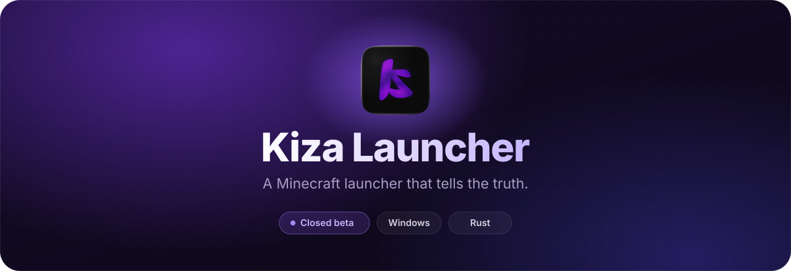
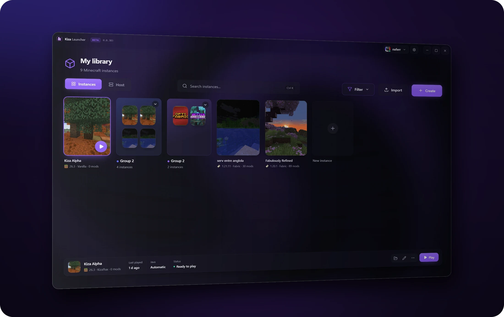
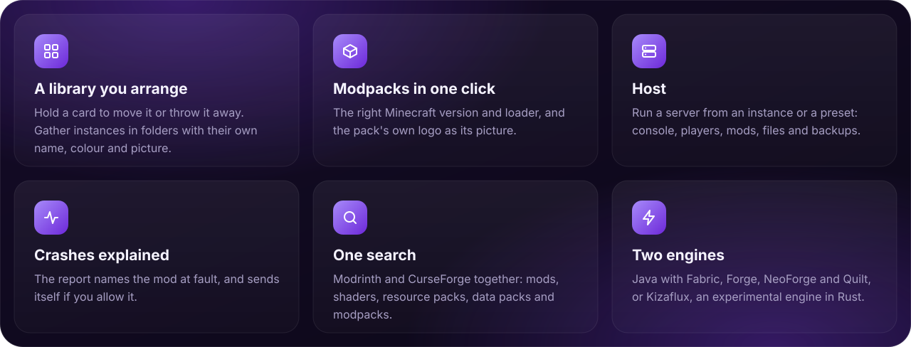
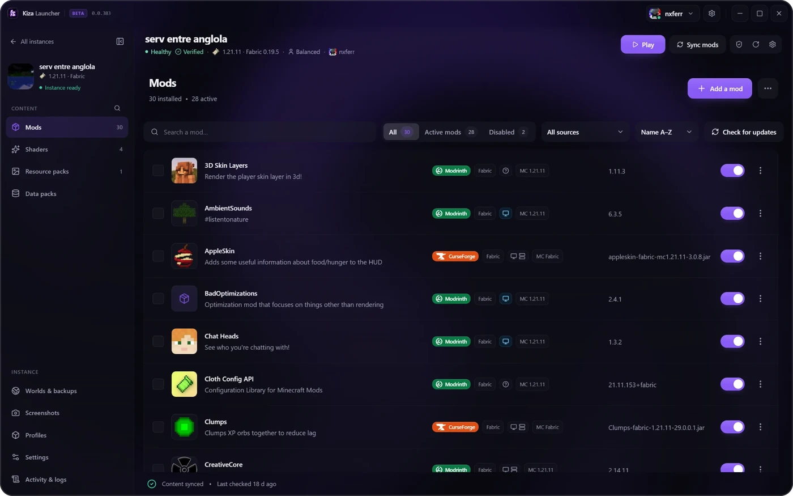
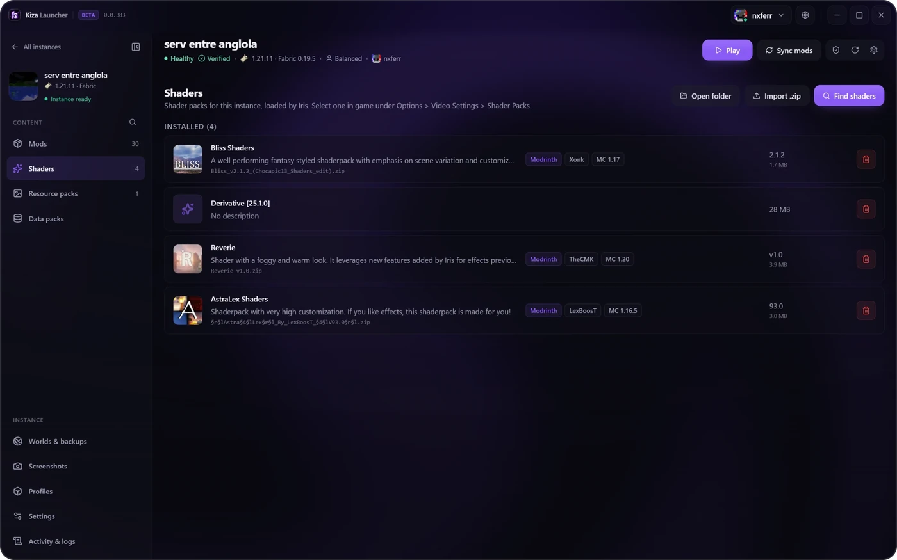
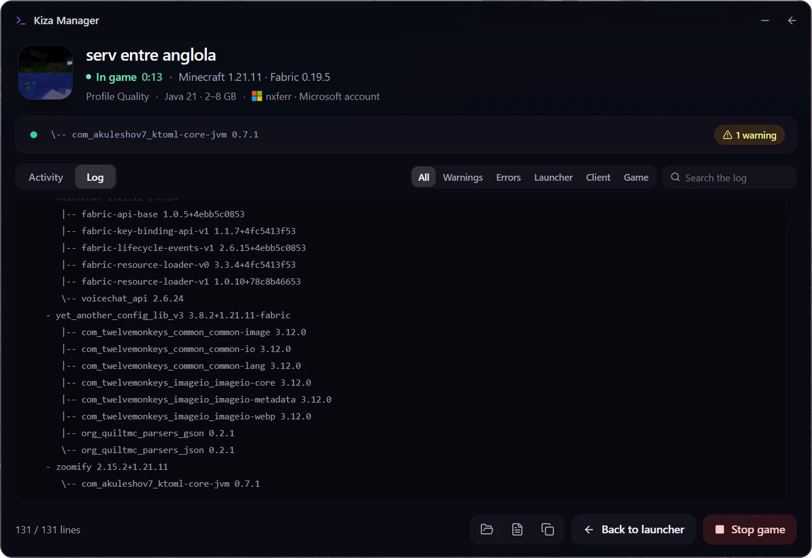
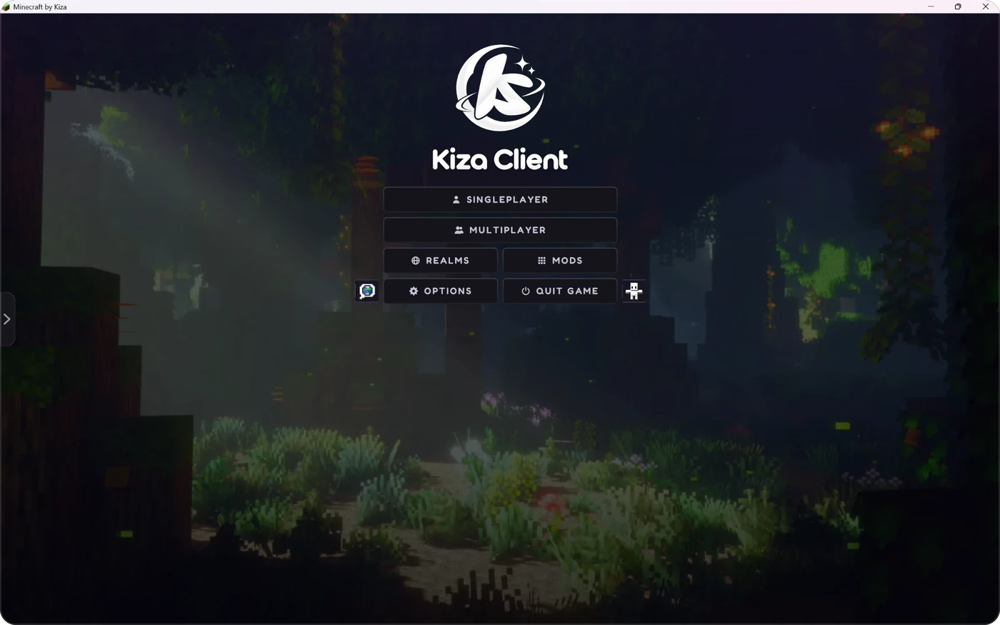
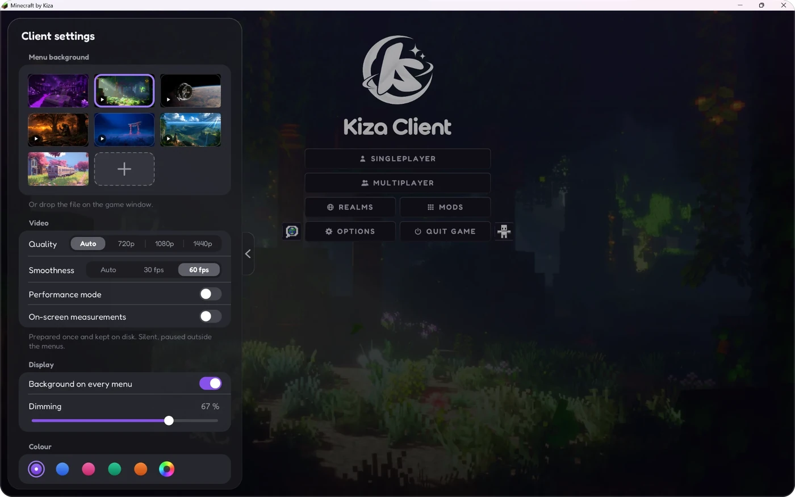
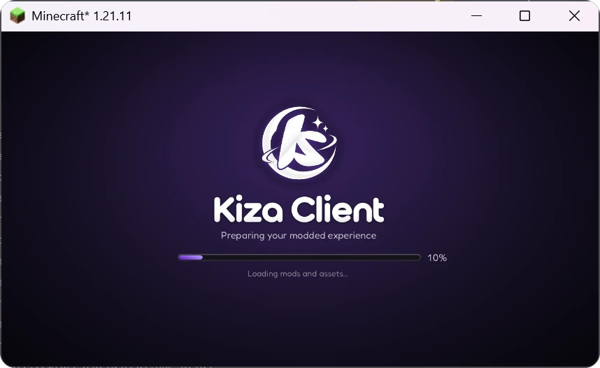

<div align="center">



<br><br>

<a href="https://discord.gg/VRJKU4u3pU"></a>
&nbsp;
<a href="https://www.patreon.com/cw/nefcode"></a>

<sub><a href="#features">Features</a> &nbsp;·&nbsp; <a href="#tour">Tour</a> &nbsp;·&nbsp; <a href="#client">Kiza Client</a> &nbsp;·&nbsp; <a href="#build">Build</a></sub>

<br>



</div>

<br>

Kiza manages Minecraft the way a launcher should. Every instance keeps its own
mods, worlds and version, and nothing leaks into its neighbour. Mods and
modpacks come from Modrinth and CurseForge through one search, and when the
game stops, the crash report names the mod rather than saying an error
occurred.

> [!NOTE]
> Kiza is in **closed beta**: the installer is handed out to testers and is not
> downloadable publicly yet. Join the [Discord](https://discord.gg/VRJKU4u3pU)
> to hear when it opens.

<a id="features"></a>

<br>

<div align="center">

</div>

<a id="tour"></a>

## A tour

<div align="center">
&nbsp;
<br>
<sub>Every kind of content in its own place, each item with its source, loader and version.</sub>
<br><br>

<br>
<sub>Kiza Manager, while the game runs: what it is doing, and its log, filtered and searchable.</sub>
</div>

<a id="client"></a>

## Kiza Client

<div align="center">
&nbsp;
<br>
<sub>A title screen of its own on a moving background, and the settings to choose it, its quality, its dimming and its colour.</sub>
<br><br>

<br>
<sub>The game starts on Kiza's own loading screen. Built for Fabric and three generations of Forge.</sub>
</div>

## Two engines

**Java**, as Mojang ships it, with Fabric, Forge, NeoForge and Quilt. Or
**Kizaflux** `experimental`, a Rust engine built on
[Horizon](https://github.com/horizon-rust/horizon): vanilla, Minecraft 26.3 only
for now.

## Signed updates

Every release is signed at build time with a key that never leaves the release
machine, and checked against a public key compiled into the launcher. A
signature that does not verify is refused, not installed. The launcher asks a
Cloudflare Worker first and falls back to GitHub releases if it does not answer.

<a id="build"></a>

## Build

```bash
cd KizaaModEngine-Tauri
npm install
npm run tauri dev
```

A release needs `KIZAMODS_CURSEFORGE_API_KEY` and a signing key, and produces
one file: the installer carries the launcher inside it, so nothing is
downloaded during installation.

```bash
npm run build:installer
```

<details>
<summary><b>Repository layout</b></summary>

<br>

| | |
|---|---|
| `KizaaModEngine-Tauri/` | the launcher: Tauri, Rust backend, React interface |
| `KizaaModEngine-Tauri/kiza-base-mod/` | the in-game client, built for Fabric and three Forge generations |
| `KizaaModEngine-Tauri/kiza-setup/` | Kiza Setup, the installer: an application rather than a wizard |
| `KizaaModEngine-Tauri/kizaflux/` | Kizaflux, the bridge between the launcher and Horizon |
| `KizaaModEngine-Tauri/cloudflare/` | the update service: a Worker serving signed releases from R2 |
| `.github/workflows/` | tests on every push, a signed release on every tag |

</details>

<br>

<div align="center">

Kiza is written by one person. No studio, no ads in the launcher, no paid edition planned.

<br>

<a href="https://discord.gg/VRJKU4u3pU"></a>
&nbsp;
<a href="https://www.patreon.com/cw/nefcode"></a>

<br><br>

<sub>Independent project. Not affiliated with Mojang, Microsoft, Modrinth or CurseForge.<br>
Minecraft is a trademark of Mojang Synergies AB.</sub>

</div>
