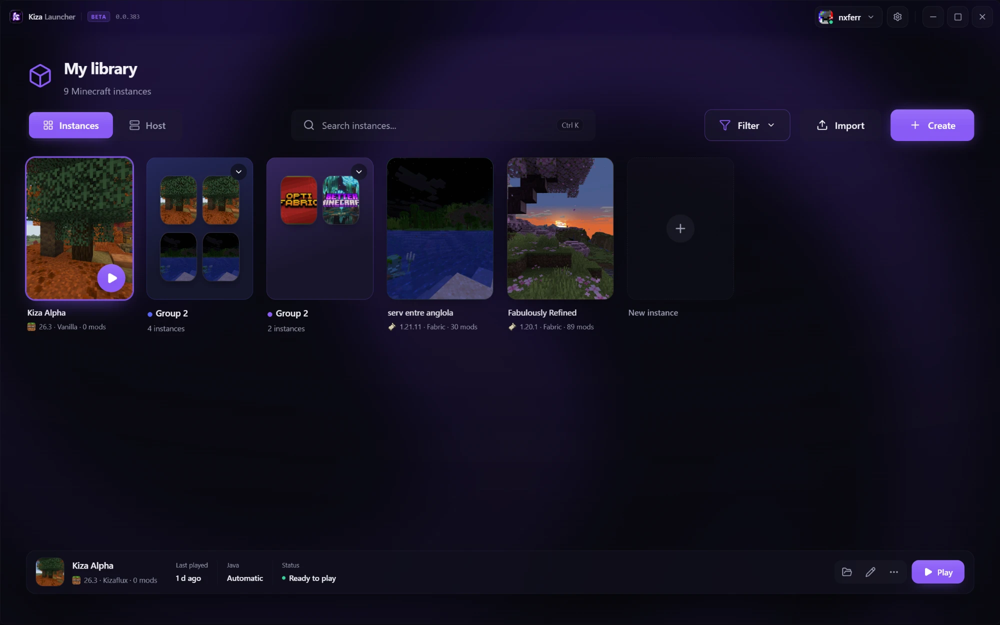
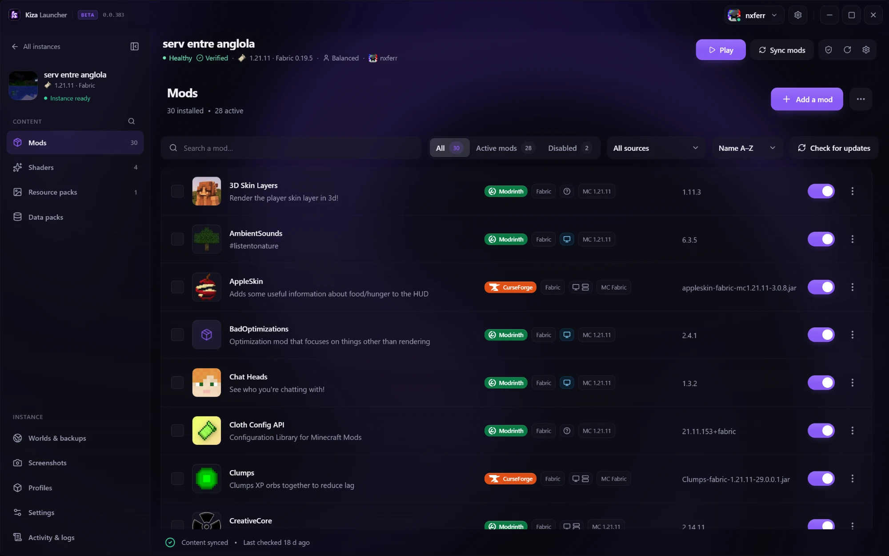
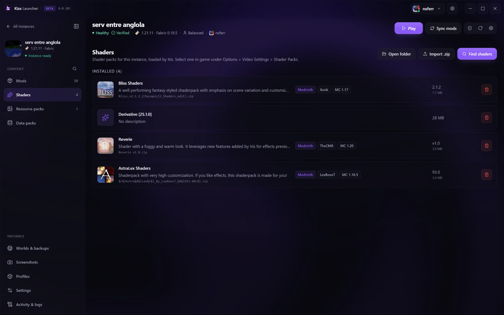
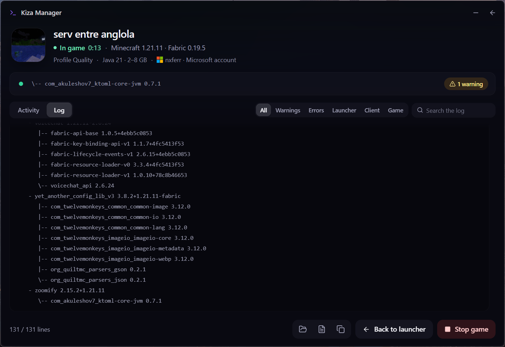
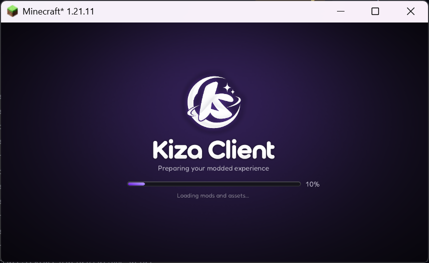
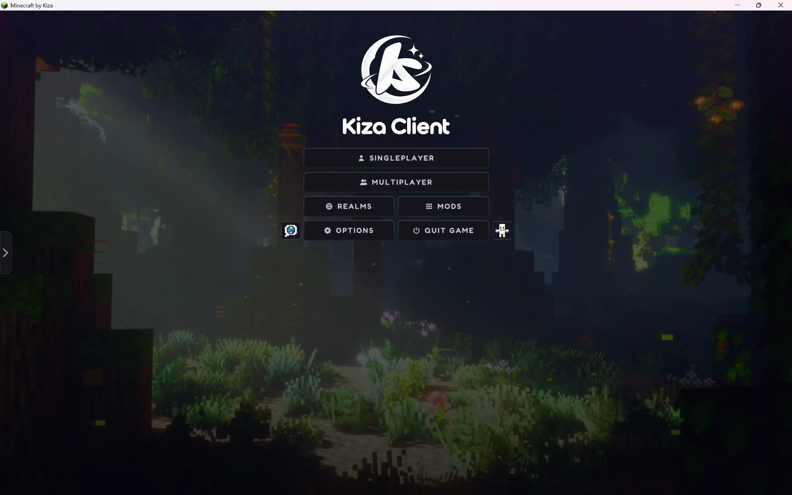
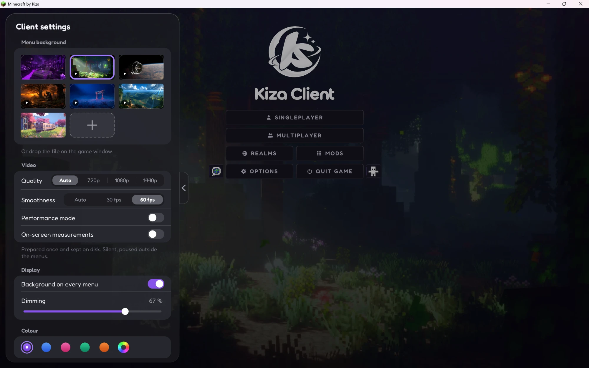

<div align="center">


# Kiza Launcher

### A Minecraft launcher that tells the truth.

Isolated instances · Modrinth and CurseForge in one search · servers hosted from the launcher · a Kiza client drawn inside the game

<br>

<a href="https://discord.gg/VRJKU4u3pU"></a>
<a href="https://www.patreon.com/cw/nefcode"></a>


<br><br>

**[Features](#features)** · **[Screenshots](#screenshots)** · **[Two engines](#engines)** · **[Updates](#updates)** · **[Building](#building)** · **[Discord](https://discord.gg/VRJKU4u3pU)**

<br>



</div>

---

## What it is

Kiza manages Minecraft the way a launcher should: every instance keeps its own
mods, worlds and version, and nothing leaks into its neighbour. Mods and
modpacks come from Modrinth and CurseForge through a single search. When the
game stops, the crash report names the mod rather than saying an error occurred.

> [!NOTE]
> Kiza is in **closed beta**: the installer is handed out to testers and is not
> downloadable publicly yet. Join the [Discord](https://discord.gg/VRJKU4u3pU)
> to follow it and hear when it opens.

<a id="features"></a>

## Features

<table>
<tr>
<td width="50%" valign="top">

### A library you arrange
Press and hold a card to move it, or to throw it in the trash. Ctrl-click
several to act on them together, or gather them in **groups**: folders with
their own name, colour and picture.

</td>
<td width="50%" valign="top">

### Modpacks in one click
A pack from the catalogue installs with the right Minecraft version and
loader, brings its own logo as the instance's picture, and flies into your
library.

</td>
</tr>
<tr>
<td width="50%" valign="top">

### Host
Create a server from an instance or a preset and run it from the launcher:
console, players, mods, files and backups, all in one place.

</td>
<td width="50%" valign="top">

### Crashes explained
The crash report names the mod at fault instead of a stack trace, and, with
your permission, reports itself so it gets fixed.

</td>
</tr>
<tr>
<td width="50%" valign="top">

### One search, two catalogues
Modrinth and CurseForge side by side, in a single search: mods, resource
packs, shaders and modpacks.

</td>
<td width="50%" valign="top">

### The Kiza client
An in-game menu drawn by Kiza, for Fabric and three generations of Forge.

</td>
</tr>
</table>

<a id="screenshots"></a>

## Screenshots

<table>
<tr>
<td width="50%"><br><sub><b>Content.</b> Mods from Modrinth and CurseForge in one list, each with its source, loader and version.</sub></td>
<td width="50%"><br><sub><b>Shaders, resource packs, data packs.</b> Each kind of content in its own place.</sub></td>
</tr>
<tr>
<td width="50%"><br><sub><b>Kiza Manager.</b> While the game runs: what it is doing, its log, filtered and searchable.</sub></td>
<td width="50%"><br><sub><b>Kiza Client.</b> The game starts on Kiza's own loading screen.</sub></td>
</tr>
<tr>
<td width="50%"><br><sub><b>A title screen of its own,</b> on a moving background.</sub></td>
<td width="50%"><br><sub><b>Client settings.</b> Choose the background, its quality, the dimming and the colour.</sub></td>
</tr>
</table>

<a id="engines"></a>

## Two engines

| Engine | What it is |
|---|---|
| **Java** | Minecraft as Mojang ships it, with Fabric, Forge, NeoForge and Quilt. |
| **Kizaflux** `experimental` | A Rust engine built on [Horizon](https://github.com/horizon-rust/horizon). Vanilla, Minecraft 26.3 only for now. |

<a id="updates"></a>

## Signed updates

Every release is signed at build time with a key that never leaves the release
machine, and checked against a public key compiled into the launcher. A
signature that does not verify is refused, not installed.

The launcher asks a Cloudflare Worker first and falls back to GitHub releases if
it does not answer. Releases go out on a channel: the Beta is the only one open,
and only an installer carrying a Beta key joins it.

<a id="building"></a>

## Building

```bash
cd KizaaModEngine-Tauri
npm install
npm run tauri dev
```

A release needs `KIZAMODS_CURSEFORGE_API_KEY` and a signing key. It produces one
file: the installer carries the launcher inside it, so nothing is downloaded
during installation.

```bash
npm run build:installer
```

<details>
<summary><b>Repository layout</b></summary>

<br>

| | |
|---|---|
| `KizaaModEngine-Tauri/` | the launcher: Tauri, Rust backend, React interface |
| `KizaaModEngine-Tauri/kiza-base-mod/` | the in-game client, built for Fabric and three Forge generations |
| `KizaaModEngine-Tauri/kiza-setup/` | Kiza Setup, the installer: an application rather than a wizard |
| `KizaaModEngine-Tauri/kizaflux/` | Kizaflux, the bridge between the launcher and Horizon |
| `KizaaModEngine-Tauri/cloudflare/` | the update service: a Worker serving signed releases from R2 |
| `.github/workflows/` | tests on every push, a signed release on every tag |

</details>

## Community and support

Kiza is written by one person. No studio, no ads in the launcher, no paid
edition planned.

<div align="center">

<a href="https://discord.gg/VRJKU4u3pU"></a>
<a href="https://www.patreon.com/cw/nefcode"></a>

</div>

---

<div align="center">
<sub>Independent project. Not affiliated with Mojang, Microsoft, Modrinth or CurseForge.<br>
Minecraft is a trademark of Mojang Synergies AB.</sub>
</div>
